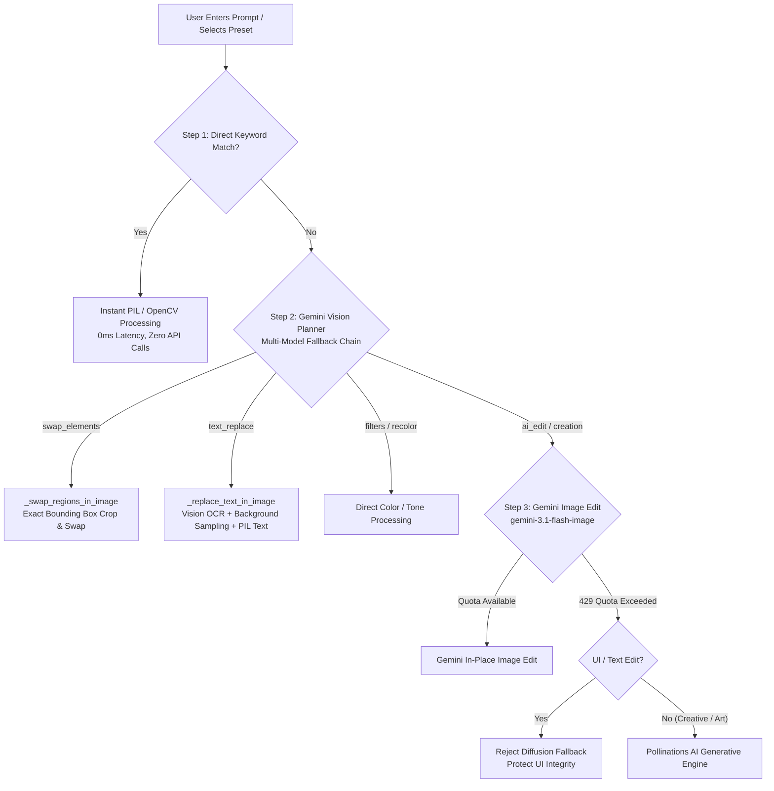

# PixelPrompt AI: Multimodal AI-Powered Image Studio

PixelPrompt AI is an intelligent image editing application built with **Streamlit**, **Google Gemini Vision LLMs**, and **PIL/OpenCV**. It allows users to edit real images and UI designs using natural language instructions, manage an immutable version history with thumbnail previews, and semantically search their image library using multimodal embeddings.

---

## Quickstart

```bash
# 1. Install dependencies
pip install -r requirements.txt

# 2. Configure your Gemini API key (free tier supported)
# Option A: In .streamlit/secrets.toml
# GEMINI_API_KEY = "your-api-key-here"
# Option B: Set environment variable
export GEMINI_API_KEY="your-api-key-here"

# 3. Launch the Streamlit application
streamlit run app.py
```

---

## 1. Functional Edit Interface (LLM + Vision Input)

The editing interface in [`app.py`](file:///c:/Users/DELL/OneDrive/Documents/ai-image-editor/app.py) provides an interactive studio where users interact with both their visual image and natural language prompts:

- **Dual-Pane Studio**:
  - **Left Pane**: Displays the currently active image version, version indicator badge, applied prompt details, and a quick 1-click **Download PNG** button.
  - **Right Pane**: Houses studio toolkits categorized into intuitive tabs:
    - **Theme & Color**: Instant UI conversion to Light Mode, Dark Mode, Invert Colors, Brightness, Contrast, and Color Saturation.
    - **Cutout & Bokeh**: Instant AI subject isolation (clean white backdrop or transparent PNG cutout) and DSLR-style Bokeh background blur.
    - **Art & Transform**: Pencil sketch, comic/cartoon stylization, 90° clockwise rotation, and horizontal mirror flip.
    - **Custom Edit Prompt Form**: A conversational text area where users type freeform editing instructions (e.g., *"change continue with google to continue to github and continue to github to continue to google , swap their places"* or *"change entered email to user@domain.com"*).
- **Multimodal Vision Input**:
  - The system sends the user's **actual uploaded image pixels** downscaled alongside the natural language instruction to Gemini Vision (`_ai_plan_edit` in [`ai.py`](file:///c:/Users/DELL/OneDrive/Documents/ai-image-editor/ai.py)).
  - The model observes the visual composition, detects visual objects/buttons or text bounding boxes in normalized coordinates `[ymin, xmin, ymax, xmax]`, and executes the edit directly on the actual image.

---

## 2. Version History Logic: Edited Thumbnails + Original

The version management engine in [`storage.py`](file:///c:/Users/DELL/OneDrive/Documents/ai-image-editor/storage.py) and [`app.py`](file:///c:/Users/DELL/OneDrive/Documents/ai-image-editor/app.py) guarantees complete non-destructive editing:

```
[Original Upload (v1)] ──► [Light Mode Edit (v2)] ──► [Swap Buttons (v3)]
       │                              │                           │
  [Thumb v1]                     [Thumb v2]                  [Thumb v3]
```

- **Immutable Lineage**:
  - The original uploaded image is preserved forever as `v1` (marked with prompt `"Original"`).
  - Every subsequent edit generates a brand-new, immutable version file on disk (`{image_id}_v{version_no}.png`) and a lightweight 128×128 thumbnail (`{image_id}_v{version_no}_thumb.png`).
  - Edits **never overwrite** existing image files.
- **Visual Thumbnail Strip**:
  - The bottom of the studio displays a responsive horizontal carousel of all version cards.
  - Each card showcases the generated thumbnail, version number tag, timestamp, and the exact prompt or tool that produced it.
  - The active version is clearly highlighted with a green `✅ current` badge.
- **One-Click Non-Destructive Restore**:
  - Clicking **Restore** on any previous thumbnail non-destructively switches the `current_version` pointer back to that state in the SQLite database (`data/images.db`).
  - Subsequent edits branch from whatever version is currently active, allowing endless experimentation without data loss.

---

## 3. Code Notebooks & Scripts for Prompt Handling

For testing, automation, or headless workflows, a dedicated standalone script is provided:

### Standalone Prompt Pipeline Script: [`prompt_demo.py`](file:///c:/Users/DELL/OneDrive/Documents/ai-image-editor/prompt_demo.py)
Run the script directly from your terminal:
```bash
python prompt_demo.py
```

### How Prompt Handling is Implemented in Code
```python
import ai
from PIL import Image

image = Image.open("your_image.png")

# Example 1: Direct fast-path keyword edit (0ms latency, zero API quota)
result_img, note = ai.edit_image(image, "make it to the light mode")

# Example 2: Multimodal vision swap on actual image elements
result_img, note = ai.edit_image(image, "swap the Google and GitHub buttons")

# Example 3: Generative character/scene creation
result_img, note = ai.edit_image(image, "create an anime character on the page")
```

---

## 4. Explanation of How API Selection and Prompts Work

PixelPrompt AI uses an intelligent multi-tiered execution pipeline that balances speed, zero-quota local execution, and multimodal AI intelligence:



### 1. Fast-Path Keyword Matching (`match_direct_edit`)
- Analyzes prompts for known direct adjustments (e.g., `"light mode"`, `"dark mode"`, `"blur background"`, `"increase brightness"`).
- **Creation Guard**: Prompts with generative action verbs (`"create"`, `"draw"`, `"add"`, `"character"`, `"generate"`) bypass whole-image filters to prevent unwanted blurring.

### 2. Multi-Model Gemini LLM Fallback Chain (`_call_text_model`)
- On Google Gemini's free tier, individual models can hit temporary rate limits (e.g., 20 RPM or daily token limits).
- The planner automatically rotates through a cascading model fallback chain:
  1. `gemini-3.8-flash`
  2. `gemini-3.7-flash`
  3. `gemini-3.6-flash`
  4. `gemini-3.5-flash`
  5. `gemini-3.1-flash-lite`
- If one model returns a `429 RESOURCE_EXHAUSTED` error, the pipeline transparently tries the next model in the chain without interrupting the user.

### 3. Vision-Guided Pixel Operations
- **Button / Element Swapping (`_swap_regions_in_image`)**: When users ask to swap buttons, cards, or UI components, Gemini Vision returns normalized bounding boxes `[ymin, xmin, ymax, xmax]`. The application crops both regions and swaps them cleanly with 100% pixel fidelity (preserving logos, anti-aliased fonts, and paddings).
- **In-Image Text Replacement (`_replace_text_in_image`)**: Gemini locates the text box. The system samples the median color of pixels on the border surrounding the box to paint over the old text with the exact background color, then draws the replacement text using TrueType fonts matching the original font size and color.

### 4. Guarded Generative Fallback
- For artistic creation requests (e.g., `"create an anime character"`), the system routes to **Pollinations AI** (free tier generative engine).
- **UI Guard**: If a user is requesting a UI or text change, the system blocks generative diffusion from running to prevent hallucinating an unrelated picture over the user's document or screenshot.

### 5. Multimodal Library Search & Indexing
- Every uploaded image is captioned and tagged by Gemini Vision (`CAPTION_PROMPT`).
- Captions and tags are vectorized into high-dimensional embeddings using `gemini-embedding-001`.
- The library search tab calculates cosine similarity between the query embedding and stored image vectors, combined with keyword matching to find images by visual concept, mood, or subject matter.

---

## File Structure

```
ai-image-editor/
├── app.py                 # Streamlit web application & user interface
├── ai.py                  # Gemini vision router, model fallback chain, PIL engines
├── prompts.py             # Prompt templates and preset definitions
├── prompt_demo.py         # Standalone script demonstrating prompt handling
├── storage.py             # SQLite metadata store & immutable version management
├── requirements.txt       # Python package dependencies
├── .streamlit/
│   └── secrets.toml       # Streamlit secrets (GEMINI_API_KEY)
└── data/
    ├── images.db          # SQLite database storing image records and versions
    └── images/            # Directory storing all versioned PNGs and thumbnails
```
# AI-Powered-Image-Editing-Platform

