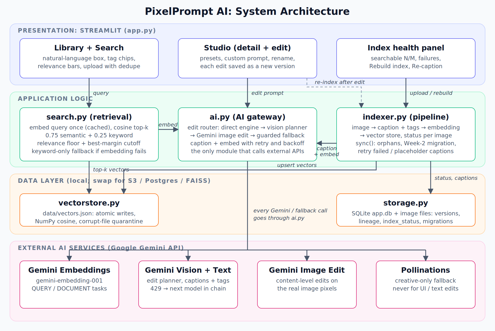
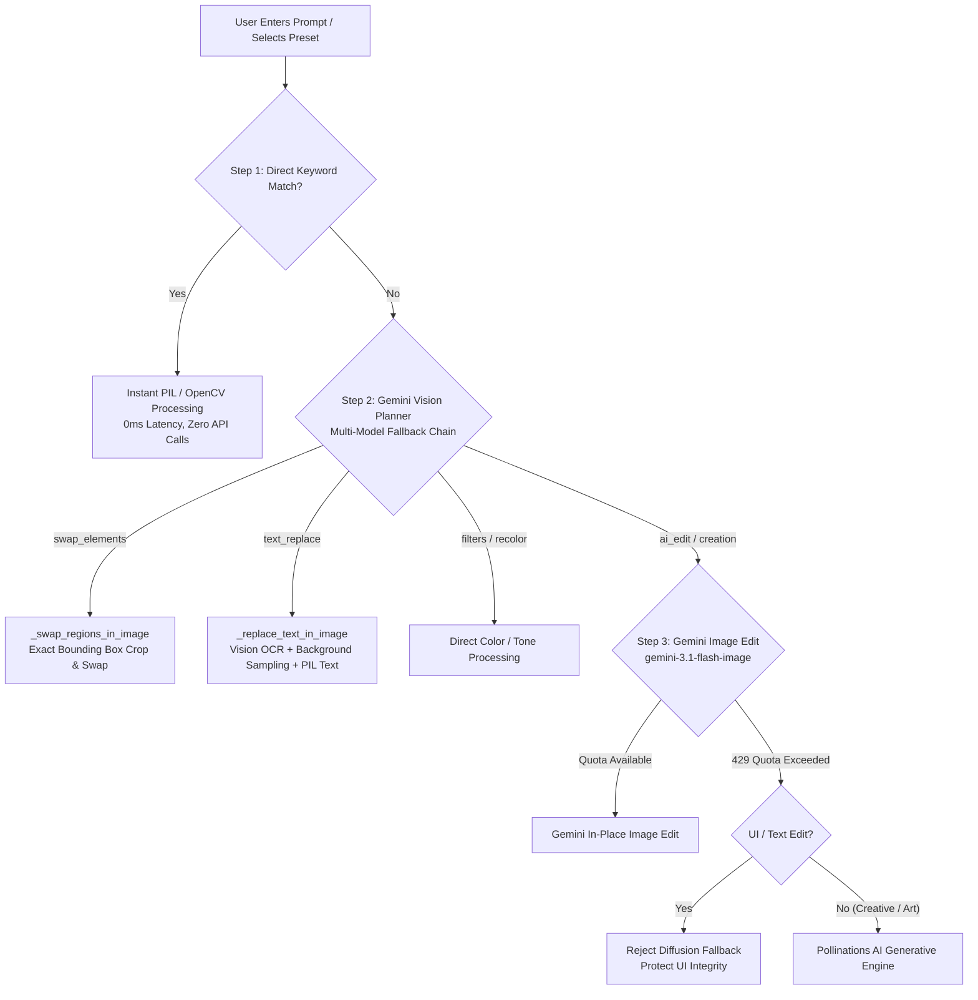

# PixelPrompt AI: Multimodal AI-Powered Image Studio

Edit images with plain English, keep a non-destructive version history, and find any photo in your library by describing it ("sunset", "a login form", "the ones with a beach").

Built with **Streamlit**, **Google Gemini** (vision, text, embeddings, image editing) and **PIL / OpenCV / rembg**. No custom models, no fine-tuning.



> Diagram source: [`docs/architecture.svg`](docs/architecture.svg)

---

## Quickstart

```bash
pip install -r requirements.txt

# Gemini API key (free tier works). Pick one:
#   a) .streamlit/secrets.toml  ->  GEMINI_API_KEY = "your-key"
#   b) environment variable     ->  export GEMINI_API_KEY="your-key"
#   c) paste it into the sidebar when the app starts

streamlit run app.py
```

Run the tests (no API key or network needed):

```bash
pip install -r requirements-dev.txt
pytest
```

---

## Usage guide

| I want to... | Do this |
|---|---|
| Add photos | Sidebar → **Upload images** → **Add to library**. Each image is captioned, tagged and indexed automatically. Exact duplicates are skipped. |
| Find photos | Type in **Search by description**. Use single words (`mountain`) or sentences (`show me the ones with a beach`). Click a suggested tag chip for a quick start. Each result shows a relevance bar. |
| Edit a photo | **Open Studio** → use a preset tab, or type a request in **Custom Edit Prompt** (`make it dark mode`, `blur the background`, `swap the Google and GitHub buttons`). |
| Go back | Version strip at the bottom → **Restore** on any thumbnail. Edits never overwrite anything; the next edit branches from the version you restored. |
| Fix search | Sidebar **Search index** shows how many images are searchable. **Rebuild index** retries anything that failed (rate limit, network). On a single image use **Re-caption & re-index**. |
| Rename / delete | In the Studio header. Deleting removes the image, all versions, files and its search vector. |

If Gemini is rate-limited or offline, search automatically falls back to keyword matching and says so, and direct (PIL/OpenCV) edits keep working.

---

## Week 3: Search, retrieval and backend

### How search works

```
upload / edit
   │  indexer.py
   ▼
Gemini vision ──► caption + 6-15 tags ──► text = caption + tags + filename
                                               │
                              Gemini embedding (gemini-embedding-001, RETRIEVAL_DOCUMENT)
                                               ▼
                                   data/vectors.json  (vectorstore.py)

query ──► Gemini embedding (RETRIEVAL_QUERY, cached per query) ──► cosine similarity
                                                                         │
            keyword score (caption, tags, filename) ───────────────────► hybrid score ──► ranked results
```

* **Embeddings for every image.** `indexer.index_image` captions the image, embeds `caption + tags + filename`, stores the vector, and records `index_status` (`ok` / `pending` / `failed`) on the image row. It runs on upload and again after each edit, so search reflects edited content.
* **Retrieval** (`search.py`): `score = 0.75 × semantic + 0.25 × keyword`. Semantic is the cosine similarity rescaled above a relevance floor; keyword is the share of query terms found in caption, tags or filename (filler like "show me the ones with" is ignored). Weak matches and anything far behind the best hit are dropped, so "mountain" does not return the whole library. Tunables (`SEM_FLOOR`, `BEST_MARGIN`, weights) are constants at the top of `search.py`.
* **Vector store** (`vectorstore.py`): a dependency-free JSON store with NumPy cosine search. Writes are atomic, a corrupt file is quarantined and rebuilt from captions, and vectors from a different embedding model are discarded automatically. It exposes only `add / delete / query`, so swapping in FAISS or Chroma later means rewriting one file.
* **Graceful degradation.** If the embedding call fails, search runs keyword-only and the UI labels it. Query embeddings are cached because Streamlit reruns the script on every click.

### Backend improvements

| Area | What changed |
|---|---|
| Data structure | `images` gained `index_status`, `index_error`, `content_hash`, `updated_at`; `versions` gained `note` (which engine ran), `width`, `height`, `size_bytes`. Indexes on `(image_id, version_no)` and `content_hash`. |
| Migrations | `storage.init()` upgrades Week-2 databases in place (idempotent). Existing embeddings are moved into the vector store with zero API calls on first launch. |
| Version tracking | Lineage via `parent_id`, engine note, pixel size and file size on every version. `set_current` refuses a version that belongs to another image. |
| Atomicity | Files are written before DB rows and removed if the insert fails; deletes remove files only after the DB commit. No orphan files or rows. |
| Error handling | Upload validation (decode check, EXIF rotation, 6000px cap), duplicate detection, retry with exponential backoff on 429/5xx/timeouts, per-image failure status instead of silent placeholders, friendly rate-limit messages. |
| Portability | Paths are stored as POSIX strings and Windows-style backslash paths already in a database are normalised on read, so a DB created on Windows works on Linux / Streamlit Cloud. |
| Tests | 25+ pytest tests covering the vector store, retrieval, indexing pipeline, storage, migration and path portability, all runnable offline. |

---

## Week 2: AI image editing and version history

### 1. Functional Edit Interface (LLM + Vision Input)

The editing interface in [`app.py`](app.py) provides an interactive studio where users interact with both their visual image and natural language prompts:

- **Dual-Pane Studio**:
  - **Left Pane**: Displays the currently active image version, version indicator badge, applied prompt details, and a quick 1-click **Download PNG** button.
  - **Right Pane**: Houses studio toolkits categorized into intuitive tabs:
    - **Theme & Color**: Instant UI conversion to Light Mode, Dark Mode, Invert Colors, Brightness, Contrast, and Color Saturation.
    - **Cutout & Bokeh**: Instant AI subject isolation (clean white backdrop or transparent PNG cutout) and DSLR-style Bokeh background blur.
    - **Art & Transform**: Pencil sketch, comic/cartoon stylization, 90° clockwise rotation, and horizontal mirror flip.
    - **Custom Edit Prompt Form**: A conversational text area where users type freeform editing instructions (e.g., *"change continue with google to continue to github and continue to github to continue to google , swap their places"* or *"change entered email to user@domain.com"*).
- **Multimodal Vision Input**:
  - The system sends the user's **actual uploaded image pixels** downscaled alongside the natural language instruction to Gemini Vision (`_ai_plan_edit` in [`ai.py`](ai.py)).
  - The model observes the visual composition, detects visual objects/buttons or text bounding boxes in normalized coordinates `[ymin, xmin, ymax, xmax]`, and executes the edit directly on the actual image.

---

### 2. Version History Logic: Edited Thumbnails + Original

The version management engine in [`storage.py`](storage.py) and [`app.py`](app.py) guarantees complete non-destructive editing:

```
[Original Upload (v1)] ──► [Light Mode Edit (v2)] ──► [Swap Buttons (v3)]
       │                              │                           │
  [Thumb v1]                     [Thumb v2]                  [Thumb v3]
```

- **Immutable Lineage**:
  - The original uploaded image is preserved forever as `v1` (marked with prompt `"Original"`).
  - Every subsequent edit generates a brand-new, immutable version file on disk (`{image_id}_v{version_no}.png`) and a lightweight 128×128 thumbnail (`{image_id}_v{version_no}_thumb.png`).
  - Edits **never overwrite** existing image files.
- **Visual Thumbnail Strip**:
  - The bottom of the studio displays a responsive horizontal carousel of all version cards.
  - Each card showcases the generated thumbnail, version number tag, timestamp, and the exact prompt or tool that produced it.
  - The active version is clearly highlighted with a green `✅ current` badge.
- **One-Click Non-Destructive Restore**:
  - Clicking **Restore** on any previous thumbnail non-destructively switches the `current_version` pointer back to that state in the SQLite database (`data/app.db`).
  - Subsequent edits branch from whatever version is currently active, allowing endless experimentation without data loss.

---

### 3. Code Notebooks & Scripts for Prompt Handling

For testing, automation, or headless workflows, a dedicated standalone script is provided:

### Standalone Prompt Pipeline Script: [`prompt_demo.py`](prompt_demo.py)
Run the script directly from your terminal:
```bash
python prompt_demo.py
```

### How Prompt Handling is Implemented in Code
```python
import ai
from PIL import Image

image = Image.open("your_image.png")

# Example 1: Direct fast-path keyword edit (0ms latency, zero API quota)
result_img, note = ai.edit_image(image, "make it to the light mode")

# Example 2: Multimodal vision swap on actual image elements
result_img, note = ai.edit_image(image, "swap the Google and GitHub buttons")

# Example 3: Generative character/scene creation
result_img, note = ai.edit_image(image, "create an anime character on the page")
```

---

### 4. Explanation of How API Selection and Prompts Work

PixelPrompt AI uses an intelligent multi-tiered execution pipeline that balances speed, zero-quota local execution, and multimodal AI intelligence:



#### 1. Fast-Path Keyword Matching (`match_direct_edit`)
- Analyzes prompts for known direct adjustments (e.g., `"light mode"`, `"dark mode"`, `"blur background"`, `"increase brightness"`).
- **Creation Guard**: Prompts with generative action verbs (`"create"`, `"draw"`, `"add"`, `"character"`, `"generate"`) bypass whole-image filters to prevent unwanted blurring.

#### 2. Multi-Model Gemini LLM Fallback Chain (`_call_text_model`)
- On Google Gemini's free tier, individual models can hit temporary rate limits (e.g., 20 RPM or daily token limits).
- The planner automatically rotates through a cascading model fallback chain:
  1. `gemini-3.8-flash`
  2. `gemini-3.7-flash`
  3. `gemini-3.6-flash`
  4. `gemini-3.5-flash`
  5. `gemini-3.1-flash-lite`
- If one model returns a `429 RESOURCE_EXHAUSTED` error, the pipeline transparently tries the next model in the chain without interrupting the user.

#### 3. Vision-Guided Pixel Operations
- **Button / Element Swapping (`_swap_regions_in_image`)**: When users ask to swap buttons, cards, or UI components, Gemini Vision returns normalized bounding boxes `[ymin, xmin, ymax, xmax]`. The application crops both regions and swaps them cleanly with 100% pixel fidelity (preserving logos, anti-aliased fonts, and paddings).
- **In-Image Text Replacement (`_replace_text_in_image`)**: Gemini locates the text box. The system samples the median color of pixels on the border surrounding the box to paint over the old text with the exact background color, then draws the replacement text using TrueType fonts matching the original font size and color.

#### 4. Guarded Generative Fallback
- For artistic creation requests (e.g., `"create an anime character"`), the system routes to **Pollinations AI** (free tier generative engine).
- **UI Guard**: If a user is requesting a UI or text change, the system blocks generative diffusion from running to prevent hallucinating an unrelated picture over the user's document or screenshot.

### 5. Multimodal Library Search & Indexing

Covered in detail in [Week 3](#week-3-search-retrieval-and-backend) above: Gemini captions and tags every image, the text is embedded with `gemini-embedding-001`, vectors live in `data/vectors.json`, and queries are ranked by hybrid semantic + keyword score.

---

## File structure

```
ai-image-editor/
├── app.py                 # Streamlit UI: library + search, studio, version history, index health
├── ai.py                  # Gemini gateway: edit router, model fallback chain, captions/embeddings (retry + backoff), PIL/OpenCV engines
├── search.py              # Retrieval: hybrid semantic + keyword ranking, query cache, keyword fallback
├── indexer.py             # Index pipeline: caption -> embed -> store, sync/rebuild, status tracking
├── vectorstore.py         # JSON vector store with NumPy cosine search (atomic writes)
├── storage.py             # SQLite + files: versions, migrations, validation, dedupe, portable paths
├── prompts.py             # Prompt templates and presets
├── prompt_demo.py         # Standalone script demonstrating prompt handling
├── tests/                 # pytest suite (offline)
├── docs/architecture.svg  # Architecture diagram (+ .png)
├── requirements.txt
├── requirements-dev.txt
└── data/                  # created at runtime (git-ignored)
    ├── app.db             # images, versions, index status
    ├── vectors.json       # embedding index
    ├── images/            # one immutable PNG per version
    └── thumbs/            # JPEG thumbnails
```

## Deployment (Streamlit Community Cloud)

1. Push the repo to GitHub.
2. Create an app on [share.streamlit.io](https://share.streamlit.io) pointing at `app.py`.
3. Add `GEMINI_API_KEY` under **Settings → Secrets**.
4. Note: Community Cloud storage is ephemeral, so uploads and the index reset when the app restarts. For a persistent deployment, move `data/` to a mounted volume or replace `storage.py` / `vectorstore.py` with S3 + Postgres/pgvector.

## Known limitations / next steps

* Relevance thresholds in `search.py` were chosen conservatively and should be tuned on your own library once you have real queries.
* The JSON vector store is ideal up to a few thousand images; beyond that use FAISS/Chroma/pgvector behind the same three methods.
* Single-user, no authentication.
* Ideas: mask/brush selection for precise edits, before/after slider, batch edits, image-embedding (CLIP-style) search alongside caption search.
